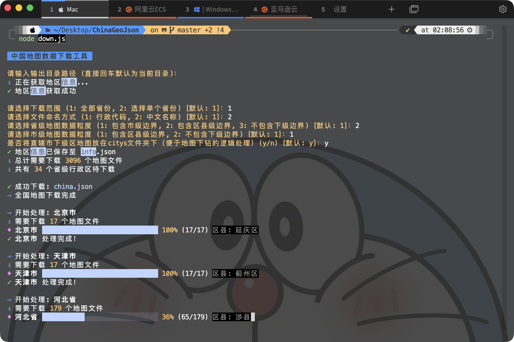

# ChinaGeoJson
## Latest nationwide provincial, municipal, district, and county map JSON data from DataV.GeoAtlas (includes Node.js batch download script)
> The map data on the official Alibaba Cloud DataV.GeoAtlas website cannot be downloaded in bulk; it can only be downloaded one by one. Recently, while working on a map drill-down feature, I needed JSON data for a large number of regions. Downloading them individually was cumbersome, so I created a simple Node.js script for batch downloading.

### Data Source
- Alibaba Cloud [DataV.GeoAtlas](https://datav.aliyun.com/portal/school/atlas/area_selector)

### Directory Structure
- `info.json`: Contains hierarchy information and latitude/longitude coordinates for all regions.
- `china.json`: Nationwide map JSON data.
- `province`: Provincial map JSON data.
- `city`: Municipal map JSON data.
- `county`: County/district map JSON data.

### Download Script
- `down.js`: Download script.

### Usage

> No dependencies need to be installed; just run it directly.
```bash
node down.js
```
> After the download completes, a `china.json` file along with `province`, `city`, and `county` directories will be generated in the current directory. These contain map JSON data for each administrative level, as well as an `info.json` file containing hierarchy information for all regions (region codes, parent codes) and geographic boundary data (such as latitude/longitude coordinates, which are convenient for positioning in ECharts scatter maps).

### Notes
- The download script automatically downloads the latest V3 version data. If you need to download V2 version data, please modify `baseUrl` and `infoUrl` in `down.js`.
- The default download directory is the current directory. If you wish to download to a different directory, please modify `outputDir` in `down.js`, for example: `const outputDir = './data';` (Note: Directory selection is now handled via interactive CLI prompts).
- By default, downloaded JSON files are named using `adcode`, which corresponds to the administrative division code for each region. If you prefer JSON files named after province/city names, please change `nameFormat` to `chinese` in `down.js` (Note: Naming format selection is now handled via interactive CLI prompts).
- You can choose the granularity for provincial and district/county level map data. By default, provincial maps only include municipal boundaries, and municipal maps include district/county boundaries. You can adjust these settings based on the interactive prompts in the console.
- To facilitate province/city drill-down logic, district-level maps for municipalities directly under the central government are placed in the `citys` folder by default. This can be changed via interactive console prompts.
- You can choose to download all provinces or specific provinces. When selecting specific provinces, you can input multiple indices separated by commas for quick downloading.



